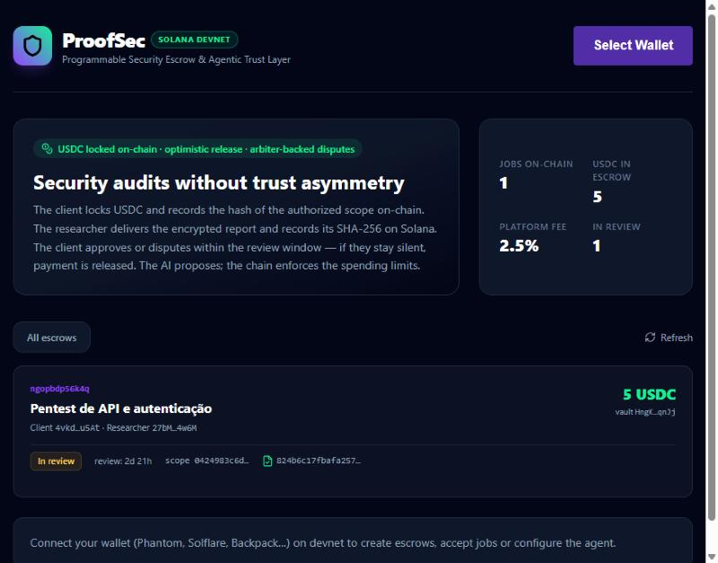
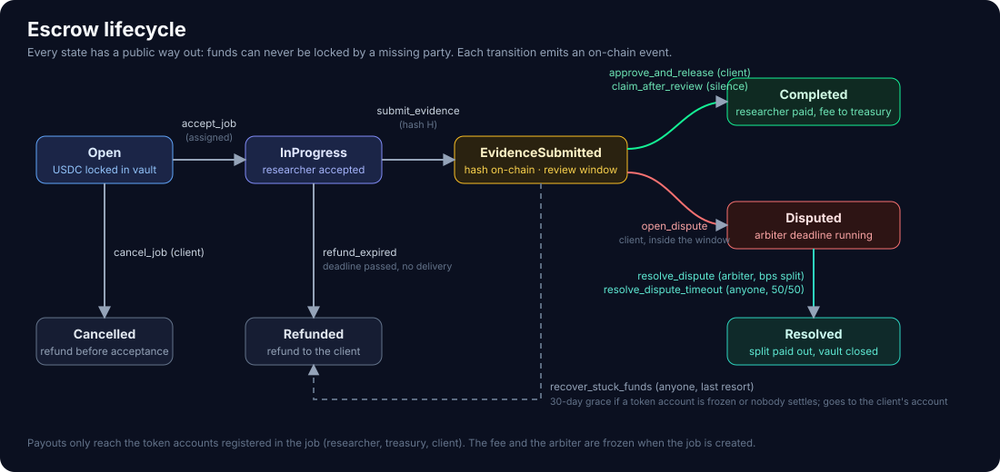
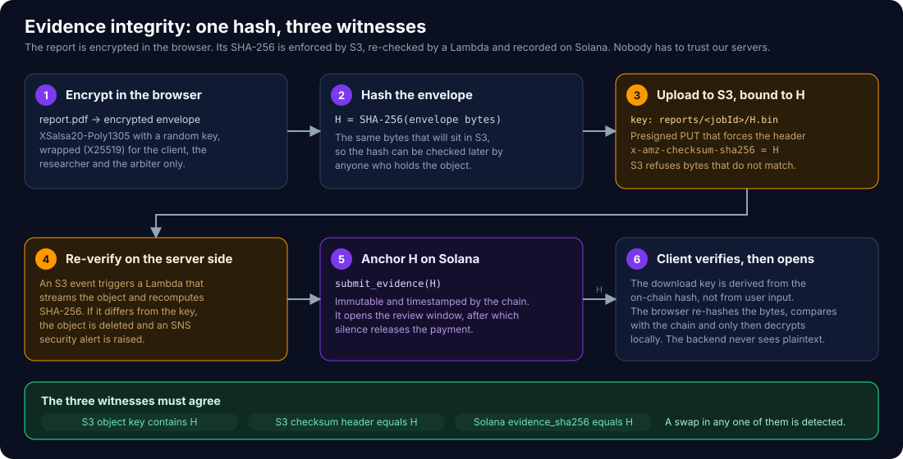
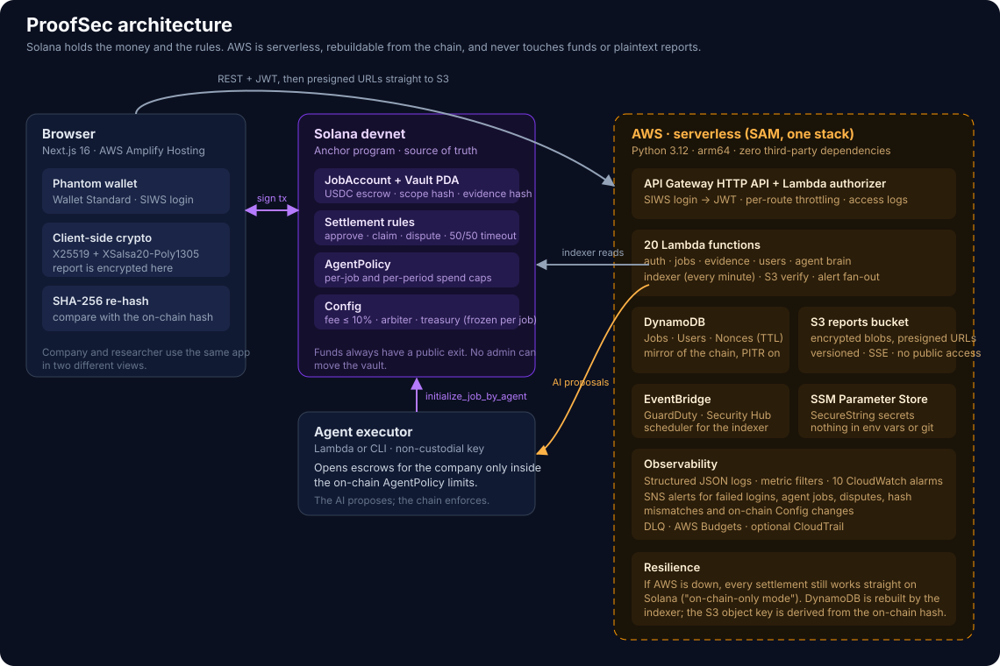

# 🛡️ ProofSec

**Programmable security escrow on Solana, backed by a serverless AWS backend.**
*The AI proposes. The chain enforces.*

[](https://explorer.solana.com/address/HCYkSp64qdMRjiCbauEzPhx9VtNGB6fp5NvKdCRb8tjj?cluster=devnet)
[](contracts)
[-FF9900?logo=amazonaws&logoColor=white)](backend-serverless)
[](frontend)
[](backend-serverless/functions)

> Built for the **Colosseum / Superteam Brasil** hackathon. 🇧🇷 Versão em português: [README.pt-BR.md](README.pt-BR.md)

<p align="center">
  
</p>

**Live demo (Solana devnet):** <https://staging.dhkblca1hli2z.amplifyapp.com> · **Program:** [`HCYkSp64…8tjj`](https://explorer.solana.com/address/HCYkSp64qdMRjiCbauEzPhx9VtNGB6fp5NvKdCRb8tjj?cluster=devnet)

---

## Table of contents

1. [The problem](#the-problem)
2. [What ProofSec does](#what-proofsec-does)
3. [How an engagement works](#how-an-engagement-works)
4. [Evidence you can verify: SHA-256 across S3 and Solana](#evidence-you-can-verify-sha-256-across-s3-and-solana)
5. [AWS architecture](#aws-architecture)
6. [Highlights: serverless, security, resilience, observability](#highlights)
7. [AI agent with on-chain spending limits](#ai-agent-with-on-chain-spending-limits)
8. [Repository layout](#repository-layout)
9. [Getting started](#getting-started)
10. [Tests](#tests)
11. [Status and limitations](#status-and-limitations)
12. [Documentation](#documentation)

---

## The problem

Hiring offensive security (pentests, audits) has a **double trust asymmetry**:

- **The company fears paying up front** and receiving a generic report, or nothing.
- **The researcher fears delivering a proof of concept** and never being paid, or having the finding fixed without a payment.
- On top of that there is a **legal problem**: testing a system without formal authorization is a crime. The authorization has to be clear, dated and verifiable. Today it lives in a PDF nobody can prove existed on a given day.

## What ProofSec does

| Piece | How it works |
|---|---|
| **USDC escrow** | The company locks USDC in a vault controlled by a Solana program. Nobody can move it by hand, not even us. |
| **On-chain testing authorization** | The SHA-256 of the scope and rules of engagement (`scope_hash`) is recorded on-chain when the job is created: a dated, verifiable authorization. |
| **Provable delivery** | The report is **encrypted in the browser**, uploaded to S3, and its SHA-256 is recorded on-chain. S3 and a Lambda enforce the same hash. |
| **Optimistic release** | After the evidence, a review window opens. The client approves (instant payout) or disputes. **If the client stays silent, the researcher can claim the payment alone.** |
| **Disputes with a way out** | A dispute goes to an arbiter who sets the split in basis points. If the arbiter disappears, anyone can apply a 50/50 split after the deadline. |
| **AI agent with a hard ceiling** | GuardDuty and Security Hub alerts become pentest proposals. The budget comes from a deterministic table (the LLM only writes text), and the agent key is **non-custodial**: an on-chain `AgentPolicy` caps what it can spend. |

## How an engagement works



1. **Company** connects Phantom, signs in with Solana (SIWS), defines the scope and locks USDC. The scope hash goes on-chain.
2. **Company** assigns a researcher (researchers can apply from the *Open jobs* view). Only the assigned wallet can accept.
3. **Researcher** accepts, tests, and uploads the encrypted report. The report hash is recorded on-chain and the review window starts.
4. **Company** downloads the report, re-hashes it in the browser, checks it against the chain, decrypts it locally, then approves or disputes.
5. **Settlement is automatic**: approval pays instantly; silence until the end of the window lets the researcher claim; a dispute is decided by the arbiter or, after a deadline, by the 50/50 fallback. Missed deadlines and cancellations refund the client.

Payouts only ever go to the token accounts registered in the job (researcher, treasury, client). The fee, the arbiter and the dispute deadline are **frozen when the job is created**, so a later config change cannot affect a running engagement. The arbiter can never be the client or the researcher of the same job.

## Evidence you can verify: SHA-256 across S3 and Solana



The report that lives in S3 is **bound to the record on Solana by one SHA-256**, and three independent witnesses must agree:

| Witness | What it enforces |
|---|---|
| **S3 object key** | The key is `reports/<jobId>/<sha256>.bin`, and the download key is derived from the hash stored **on-chain**, never from user input. |
| **S3 checksum** | The presigned `PUT` forces `x-amz-checksum-sha256`, so S3 itself rejects bytes that do not match the hash. |
| **Solana record** | `submit_evidence(sha256)` stores the same hash immutably and timestamps it. It also opens the review window. |

On top of that:

- A **Lambda** (`verify_upload`) is triggered by the S3 event, streams the object, recomputes SHA-256 and **deletes the object and raises an SNS security alert** if it does not match its key.
- The **client's browser re-hashes** the downloaded bytes and compares them with the on-chain hash **before decrypting**. A swapped object is detected even if the backend were compromised.
- Reports are **end-to-end encrypted** (X25519 + XSalsa20-Poly1305). The backend and S3 only ever hold ciphertext, and the key is wrapped only for the client, the researcher and the arbiter. A wallet's encryption key must carry a signature proving the wallet owns it before anyone encrypts to it.

## AWS architecture



The whole backend is one **AWS SAM** stack (`backend-serverless/template.yaml`). **Solana is the source of truth** for funds, status and hashes; AWS mirrors state, stores encrypted reports and runs the agent's "brain". If DynamoDB and the data it holds disappear, the indexer rebuilds it from the chain.

| Layer | Services | Role |
|---|---|---|
| Edge | **AWS Amplify Hosting**, **API Gateway HTTP API** | Static Next.js app; 16 routes with per-route throttling and a **Lambda authorizer** (SIWS → JWT). |
| Compute | **20 AWS Lambda functions**, Python 3.12, arm64, **no third-party dependencies** | Auth, jobs, evidence, users, agent brain, indexer, S3 verification, alert fan-out. |
| Data | **DynamoDB** (Jobs, Users, Nonces with TTL; point-in-time recovery on Jobs and Users), **S3** | Chain mirror and metadata; encrypted reports (versioned, SSE, public access blocked). |
| Events | **EventBridge** (+ Scheduler), **SQS DLQ** | GuardDuty and Security Hub findings; the indexer runs every minute; failed async work lands in a DLQ. |
| Secrets | **SSM Parameter Store** (`SecureString`) | JWT secret, agent key, LLM key. Nothing in plain env vars or in git. |
| Operations | **CloudWatch Logs, metric filters and alarms**, **SNS**, **AWS Budgets**, optional **CloudTrail** | See [Observability](#observability). |

## Highlights

### Serverless

- **100% managed, pay-per-use**: HTTP API, Lambda, DynamoDB on-demand, S3, EventBridge. Nothing to patch, nothing idle to pay for.
- **Zero third-party Python dependencies**: JWT (HS256), Base58 and Ed25519 signature verification are implemented in pure Python, which keeps packages tiny, cold starts short and the supply-chain surface small.
- **Infrastructure as code**: one SAM template, validated with `sam validate --lint` and a template checker, with `Rules` that refuse unsafe production parameters (wildcard CORS, localhost login, placeholder program id).

### Security

- **Funds never depend on the backend.** The backend holds no wallet keys and cannot move money. Every value-moving rule is enforced by the program (signers, PDAs, token-account checks, state machine, checked arithmetic).
- **Identity comes from the authorizer, never from the request body**: Sign-In With Solana, single-use nonces with a TTL, expiring JWTs.
- **Reports are encrypted client-side** and bound to a verifiable hash (see above).
- **The LLM never decides money.** Amounts, recipients and deadlines come from a deterministic policy table; model output is text only, schema-validated and treated as untrusted input (alert contents may contain prompt injection).
- **Non-custodial agent**: its key can only move company funds into company-owned escrows, within the on-chain `AgentPolicy` limits per job and per period.
- **Hardened web app**: strict Content-Security-Policy and security headers (`frontend/customHttp.yml`), with `connect-src` pinned to the API and the reports bucket.
- **Reviewed deployments**: infrastructure changes go out as CloudFormation changesets that a human reviews and executes.
- **Adversarial testing**: every program instruction has tests for the happy path, wrong signer, wrong account, wrong state and boundaries. Findings are tracked as `PS-xx` in [`docs/security-review.md`](docs/security-review.md), each with a regression test that is never deleted (for example: arbiter independence, treasury frozen per job, upgrade-authority-only config init).

### Resilience

- **Funds always have a public exit.** Approve, claim after the window, arbiter resolution, **50/50 timeout** when the arbiter is inactive, refund after the deadline, cancel before acceptance, and a **last-resort recovery after 30 days** if a token account is frozen. Anything that could lock funds forever is treated as a critical bug.
- **On-chain-only mode**: if AWS is down, the web app still creates escrows, accepts jobs, records hashes and settles directly on Solana.
- **Self-healing mirror**: the indexer reconciles DynamoDB from the chain every minute; the chain wins on any disagreement. Sync is idempotent, writes are conditional, and no component ever re-sends a signed transaction blindly.
- **RPC fallback** for reads, DynamoDB **point-in-time recovery**, **S3 versioning**, and a DLQ for failed asynchronous processing.
- The failure analysis (RPC, DynamoDB, S3, Lambda, LLM, arbiter, account loss) with detection, fallback and recovery is in [`docs/resilience.md`](docs/resilience.md).

### Observability

- **Structured JSON logs** (one event per line, never secrets, tokens, signatures or report contents) with explicit retention.
- **CloudWatch metric filters and 10 alarms** on API 5xx, authorizer errors, repeated login failures, evidence-verification errors, indexer failures (including per-item failures it survives), agent errors, Lambda throttles and the DLQ.
- **SNS security alerts** for: jobs opened by the agent, evidence on agent jobs, disputes, an upload deleted for a hash mismatch, and **on-chain `Config` changes** detected by the indexer.
- **API Gateway access logs**, **AWS Budgets** for cost, and an optional **CloudTrail** trail.
- Alert levels: Informational · Warning · Critical · Security incident.

## AI agent with on-chain spending limits

```
GuardDuty / Security Hub  →  EventBridge  →  agent "brain" (Lambda, no keys)
    severity → budget from a fixed table → LLM drafts title/targets/test plan (optional, with template fallback)
    → scope document + scope_hash → proposal: AUTO_APPROVED (under the ceiling) or NEEDS_HUMAN
                                                       │
agent "hands" (executor, non-custodial key)  ←─────────┘
    signs initialize_job_by_agent  →  the program re-checks AgentPolicy (per-job and per-period caps)
```

Agent jobs are created **without a researcher** (the company assigns one) and with a **minimum 72 h review window**. Even if the backend or the model were compromised, the on-chain policy is the ceiling. The kill switch is disabling the schedule or deactivating the policy on-chain.

## Repository layout

```
contracts/            Anchor program (Rust): escrow, disputes, agent policy, tests, IDL sync
backend-serverless/   AWS SAM stack: template.yaml, Lambda functions, unit tests
agent/                Agent executor (CLI and Lambda) and an offline demo of the brain
frontend/             Next.js app: wallet, client-side crypto, on-chain calls
tests/                Cross-component tests (meta integrity, key binding, CSP, roles)
docs/                 Architecture, program design, threat model, security review,
                      resilience, runbook, ADRs, technical manual (PDF)
```

## Getting started

### 1. Program (WSL2, Linux or macOS)

```bash
cd contracts
npm install
anchor build            # the post_build hook copies the real IDL to frontend/ and agent/
anchor test             # 36 tests, including attacks and clock-dependent scenarios
```

Deploying to devnet needs a funded keypair. See [`contracts/AGENTS.md`](contracts/AGENTS.md) and [`docs/runbook.md`](docs/runbook.md). The platform `Config` can only be initialized by the program's upgrade authority.

### 2. Backend (AWS)

```bash
cd backend-serverless
python -m unittest discover -s tests -v      # local tests, no AWS needed (pip install cryptography)
sam validate --lint
sam build
sam deploy --no-execute-changeset            # review the changeset, then execute it
```

Secrets (`/proofsec/<stage>/jwt-secret`, `agent-api-key`, optional LLM key) live in SSM Parameter Store. See the runbook.

### 3. Frontend

```bash
cd frontend
cp .env.example .env.local        # set NEXT_PUBLIC_API_URL to the stack's ApiEndpoint
npm install
npm run dev
```

Without `NEXT_PUBLIC_API_URL` the app runs in **on-chain-only mode**. Phantom must be on **Devnet**; get test USDC at [faucet.circle.com](https://faucet.circle.com).

### 4. Agent

```bash
python agent/agent.py --severity 5          # offline demo of the brain (same code as the Lambda)
cd agent && npm install && npm test         # executor tests, no network
npm run keygen                              # then register the pubkey in the app's agent policy panel
API_URL=... AGENT_API_KEY=... npm run executor
```

## Tests

| Area | Command | Coverage |
|---|---|---|
| Solana program | `cd contracts && anchor test` | 36 tests: happy paths, authorization attacks, wrong accounts and states, boundaries, clock-dependent flows |
| Backend | `npm run test:backend` | 100+ tests with AWS faked: auth, jobs, evidence, agent, policy, template rules |
| Executor | `npm run test:agent` | 18 tests |
| Frontend libs | `npm run test:meta` | Integrity checks, key binding and key-version freeze, roles, CSP |
| Static checks | `npm run check:templates`, `npm --prefix frontend run typecheck` | SAM templates and TypeScript |

## Status and limitations

This is a hackathon MVP running on **Solana devnet only**, with test USDC.

- It has had extensive internal adversarial review but **no external audit**.
- The arbiter and treasury are single wallets; production should use a multisig (for example Squads) and the same for the upgrade authority.
- Disputes currently have a single arbiter with a deadline fallback; a decentralized arbitration or reputation layer is future work.
- Next steps: hold the vault in a yield-bearing USDC so the yield becomes a researcher bonus, an attestation of reputation on release, and bug-bounty support.

## Documentation

| Document | What is inside |
|---|---|
| [`docs/architecture.md`](docs/architecture.md) | Domains, AWS components, main flow, agent |
| [`docs/program-design.md`](docs/program-design.md) | Accounts, PDAs, byte layout, state machine, on-chain invariants |
| [`docs/threat-model.md`](docs/threat-model.md) | Assets, actors, trust boundaries, STRIDE |
| [`docs/security-review.md`](docs/security-review.md) | Findings with severity, regression test and status |
| [`docs/resilience.md`](docs/resilience.md) | Dependencies, fallbacks, monitoring, idempotency |
| [`docs/runbook.md`](docs/runbook.md) | Deploy order, incident response, disaster recovery, demo checklist |
| [`docs/decisions.md`](docs/decisions.md) | Architecture decision records (ADRs) |
| [`docs/ProofSec_Manual_Tecnico.pdf`](docs/ProofSec_Manual_Tecnico.pdf) | Technical manual with diagrams (Portuguese) |

Much of the internal documentation is written in Portuguese.
